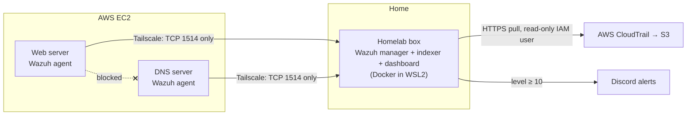
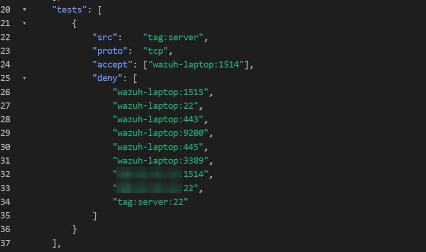
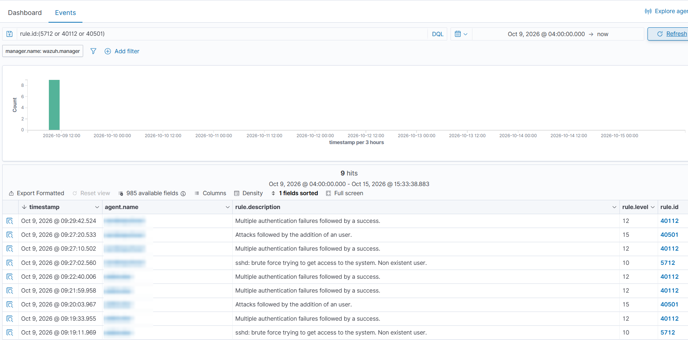
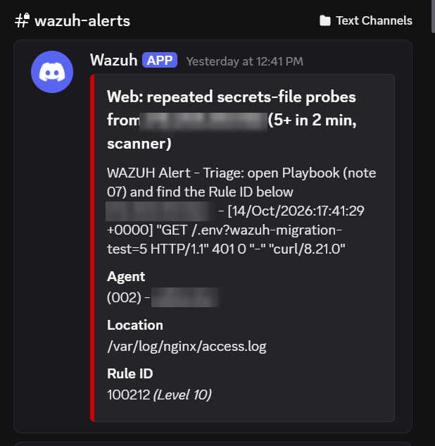
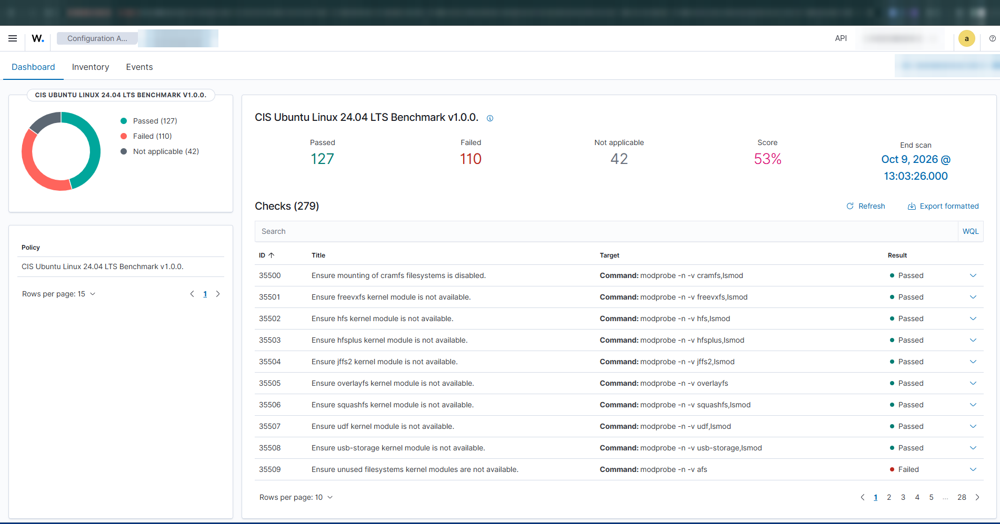
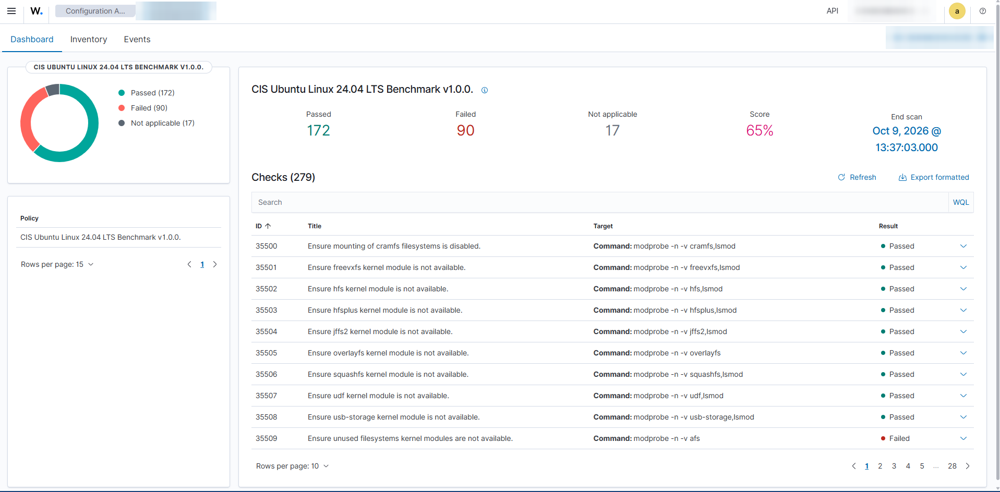

<div align="center">

# Wazuh Home SOC

**A home SOC for my AWS servers: Wazuh SIEM over Tailscale, 32 tested detection rules, $0 extra cost**

[](https://github.com/pokharelsandeep333-commits/wazuh-home-soc/actions/workflows/rules.yml)
[](LICENSE)


| 32 | 36 / 36 | 3 + AWS | 53% → 65% | 0 |
|:---:|:---:|:---:|:---:|:---:|
| custom rules | tests passing in CI | endpoints + account monitored | CIS score, web server | SIEM ports open to the internet |

[Architecture](#architecture) · [Detections](#what-it-detects) · [Attack test](#attacking-my-own-servers) · [Hardening](#cis-hardening) · [What broke](#what-broke-and-how-i-fixed-it) · [Rebuild it](#rebuild-it-yourself)

</div>

---

I run two public servers on AWS: one hosts my websites, Nextcloud and a CI/CD project, the other is a DNS-over-HTTPS ad-blocking resolver. Bots scan them every day, and until this month I had no idea what was hitting them.

So I built a small Security Operations Center for them. Wazuh collects their security logs and alerts me when something looks wrong, connected to the servers over Tailscale. I tested it by attacking my own servers, and fixing what broke took up most of the week. This repo has everything needed to rebuild it.

## Architecture

Wazuh needs about 8 GB of RAM, more than my student AWS credits could pay for, so it runs at home. Its agents *push* logs, and a home router drops every connection that starts on the internet. Tailscale solves that without opening a single port ([options I compared](docs/01-tailscale.md)).



The [Tailscale policy](tailscale/policy.hujson) is written so that a hacked server can't reach anything else:

- Servers reach the Wazuh box on **TCP 1514 only**. SSH, SMB, RDP and the dashboard are refused.
- **Servers can't reach each other**, which blocks lateral movement.
- The policy has **built-in tests**: Tailscale refuses to save an edit that would open a denied path.
- The dashboard, API and indexer listen on `127.0.0.1` only. I reach the dashboard through an SSH tunnel.
- **Public port 22 is closed** on both servers. Admin access goes through Tailscale SSH, tied to my Tailscale identity instead of a key file on disk.

<p align="center"></p>

## What it detects

| Area | What I set up |
|---|---|
| File integrity | Real-time monitoring of SSH config, nginx config and app folders. Alerts within about 1 second, with the user who made the change |
| Web attacks | nginx logs from both servers, including a log file I added for the Dockerized nginx, which had only logged to stdout |
| Secrets-file probes | Rules 100210-100212 for `/.env`, `/.git/`, `/.aws/`. They escalate if the probe got a 200 or if one IP keeps trying |
| AWS account | CloudTrail via a read-only IAM user (CloudFormation). Rules for root logins, new IAM users and keys, AdministratorAccess grants, MFA removal and CloudTrail tampering |
| Linux audit | 53 CIS audit rules, plus custom rules for sudoers changes, kernel modules and sudo-log tampering |
| Containers | Docker events on both servers: `docker exec`, shells inside containers, containers destroyed |
| Vulnerabilities | Host package CVE scanning, tuned so unfixable kernel CVEs don't flood my phone |
| Notifications | Discord message for every alert at level 10 or above |
| Who watches the watcher | A 5-minute health check that alerts if Wazuh itself goes down, and an Uptime Kuma dead-man's switch for the whole host |

The rules are in [wazuh/rules/](wazuh/rules/). [wazuh/tests/](wazuh/tests/) replays 36 sample events through `wazuh-logtest`, most of them in pairs: the event a rule should catch or silence, and a similar one that must still alert. [CI](.github/workflows/rules.yml) runs them against a clean Wazuh 4.14.8 manager on every push.

## Attacking my own servers

I ran an attack chain against my own DNS server: 10 failed SSH logins as a fake user, a real login, then creating and deleting a user. Wazuh linked the events on its own:

| Time (UTC) | Rule | Level | What Wazuh concluded |
|---|---|:---:|---|
| 14:19:09 | 5710 ×19 | 5 | Login attempts with a non-existent user |
| 14:19:11 | 5712 | 10 | SSH brute force |
| 14:19:33 | 40112 | 12 | Failed logins followed by a success from the same IP |
| 14:20:03 | 40501 | **15** | Attack followed by a new user being added |

<p align="center">
<br><sub>The chain on both servers, Oct 9 2026 (times in US Central). Server names blurred.</sub></p>

Other live tests:
- **Secrets probes:** none of my five hostnames served `/.env` or `/.git/config`. Cloudflare's edge already blocked `/.env` on the proxied sites.
- **AWS root login:** rule 100200 (level 12) about 7 minutes later ([screenshot](docs/evidence/README.md#aws-root-console-login-caught-oct-10-2026)).
- **File integrity:** create, edit and delete each alerted within about 1 second on all three machines.
- **Discord:** six probes produced 100210 five times, then 100212, and the message arrived in the channel.

<p align="center"></p>

## CIS hardening

| Machine | Before | After |
|---|:---:|:---:|
| Ubuntu 24.04 web server | 53% | **65%** |
| Windows 11 homelab box | 25% | **45%** |

<p align="center">
  
  
  <br><sub>Web server, Oct 9 2026: 53% at 13:03, 65% at 13:37 after two hardening batches</sub>
</p>

Every check I skipped has a written reason and a compensating control, in an [exception register](docs/04-detections.md#cis-hardening). I also found a bug in Wazuh's own CIS policy (a check that can never pass because its file pattern is missing an `r:` prefix) and reported it as [wazuh/wazuh#40275](https://github.com/wazuh/wazuh/issues/40275).

## What broke, and how I fixed it

| # | Problem | Fix |
|:---:|---|---|
| 1 | The SIEM filled the disk and crashed itself | Capped WSL memory; Windows had grown the pagefile to back it |
| 2 | Vulnerability scanning wrote 4.4 GB a minute | Measured it, disabled it until a host with 164 GB free |
| 3 | Docker's firewall rule overrode mine | Block every address except Tailscale's; enrollment port closed |
| 4 | Windows reserved my API port and Docker dropped every port | Moved the API below Windows' dynamic port range |
| 5 | Wazuh said "sent", Discord returned 400 | One config option overrides the timestamp Discord rejects |
| 6 | 58 "trojaned binary" alerts on Ubuntu 26.04 | Proved a false positive, narrow rule + FIM on the real binaries |
| 7 | 14,000 health-check alerts a day | Six rules, each for one exact command in one container |
| 8 | The SIEM died and nothing told me | An outside health check with auto-heal |

<details>
<summary><b>The full story behind each one</b></summary>

<br>

**1. The SIEM filled the disk and crashed itself.** On the first start, Docker's Linux VM had no memory cap. It took 13 GB of RAM, Windows grew the pagefile by 7 GB to back it, and the disk hit 0 bytes. The crash cut a database keystore file off mid-write, which left the indexer stuck in a restart loop. I capped WSL memory at 8 GB and recreated the container.

**2. Vulnerability scanning ate 4.4 GB a minute.** I measured it with a baseline, a reading every minute and a stop condition: it used 19 GB in 5 minutes and was only a third done. I turned it off until the move to the homelab box (164 GB free), where the feed loaded in 14 minutes.

**3. Docker's firewall rule overrode mine.** My Windows Firewall rule blocked the agent ports from private LAN ranges, but Docker Desktop had installed its own rule allowing any port from any address on public networks. On campus Wi-Fi, where peers may have non-private addresses, a stranger could have registered a fake agent. I replaced my rule with a block for every address except Tailscale's ranges (block rules beat allow rules) and closed the enrollment port for good.

**4. Windows reserved my port, and Docker took every other port down with it.** After a restart, Windows reserved TCP 54965-55064, and my Wazuh API port (55000) fell inside that range. When one host port fails to bind, Docker publishes none of the container's ports, so the agent port disappeared too and both servers went dark. My health check caught it.

**5. Wazuh said "sent", but Discord never got the message.** Discord accepts Slack-format webhooks, so I used Wazuh's Slack integration. Wazuh logged success while Discord rejected every message with HTTP 400. Testing one field at a time showed the cause: Wazuh sends a timestamp as a decimal string, which Slack accepts and Discord doesn't. One config option overrides it, so no Wazuh code changed.

**6. A "trojaned binary" alert, 58 times.** Wazuh flagged `ls`, `cat`, `chmod` and others on my Ubuntu 26.04 server. Ubuntu 26.04 replaced them with a single Rust binary, byte-for-byte identical to a fresh copy from Ubuntu's archive, and Wazuh's old string signatures matched normal text inside it. I wrote a rule for exactly those 10 paths and added file monitoring on the real binaries, so tuning didn't leave a blind spot.

**7. Alert fatigue: 14,000 alerts a day.** Docker runs every container health check as a `docker exec`. Six tuning rules each match one exact command in one exact container; a shell or an extra command still alerts. My phone now gets about 0-2 alerts a day, and they're real.

**8. The SIEM died and nothing told me.** Twice, the manager container showed "Up" while every process inside it was dead, and every alert comes from Wazuh. A separate health check now tests the processes, agents and event flow, posts DOWN and RECOVERED to Discord, and restarts the manager once when it finds the "zero processes" failure.

All 23 problems are in [docs/08-troubleshooting.md](docs/08-troubleshooting.md).

</details>

The SIEM later moved from my daily laptop to an always-on homelab box with about 12 minutes of downtime and no agent re-enrollment ([how](docs/07-watcher-and-migration.md#moving-the-siem-to-new-hardware)).

## Rebuild it yourself

Follow the docs in order. Values in angle brackets (`<WAZUH_MANAGER_IP>`, `<CLOUDTRAIL_BUCKET>`...) are placeholders for your own.

1. [Tailscale: the private network](docs/01-tailscale.md)
2. [Deploy Wazuh](docs/02-wazuh-deploy.md)
3. [Agents](docs/03-agents.md)
4. [Detections, tuning and CIS hardening](docs/04-detections.md)
5. [AWS CloudTrail](docs/05-cloudtrail.md) (optional)
6. [Discord alerts](docs/06-discord-alerts.md)
7. [The watcher, dead-man's switch and moving the SIEM](docs/07-watcher-and-migration.md)
8. [Troubleshooting](docs/08-troubleshooting.md)

Parts are specific to my machines and the docs say so: the Wazuh host is Windows with WSL2, one server runs Ubuntu 26.04, and the container names in the tuning rules are examples to replace.

<details>
<summary><b>Repository layout</b></summary>

```
├── tailscale/policy.hujson          access policy with built-in tests
├── wazuh/
│   ├── manager/                     compose changes + manager config (aws-s3, Discord, vulnerability detection)
│   ├── agent/                       agent config (FIM, nginx logs, Docker listener, audit log)
│   ├── rules/                       home_soc_detections.xml, home_soc_tuning.xml
│   └── tests/                       36 logtest cases + runner
├── scripts/
│   ├── server/                      agent install, web logs, Docker listener, CIS batches, sudo.log rotation
│   ├── manager/                     rule deploy, watcher + systemd units, Discord and AWS secret helpers
│   └── windows/                     CIS Windows 11 hardening
├── aws/wazuh-cloudtrail-reader.yaml read-only IAM user (CloudFormation)
└── docs/                            the eight guides
```

</details>

## Limits

- A home lab watching three machines, and I'm the only one on call.
- Vulnerability scanning covers host packages, not software inside Docker images. Image scanning is next.
- Wazuh has no CIS policy yet for Ubuntu 26.04, so the DNS server has no hardening score.

## How I built it

I designed it, made the security decisions, ran the attack tests, and ran everything that needed admin rights or a secret myself. I used Claude Code as an assistant for research, scripting and troubleshooting, and kept a dated build log of every step, including what failed. Every result here comes from that log.

## Evidence

- Bug report to Wazuh: [wazuh/wazuh#40275](https://github.com/wazuh/wazuh/issues/40275)
- Rule tests: the [CI runs](https://github.com/pokharelsandeep333-commits/wazuh-home-soc/actions/workflows/rules.yml) on this repo
- Screenshots: [docs/evidence/](docs/evidence/) (more coming, plus a walkthrough video)
- I'm happy to demo it live.

---

<sub>[MIT License](LICENSE) · [Security notes](SECURITY.md) · Rule 31151 in `home_soc_tuning.xml` is adapted from the [Wazuh ruleset](https://github.com/wazuh/wazuh) (GPLv2), with only its level changed.</sub>
