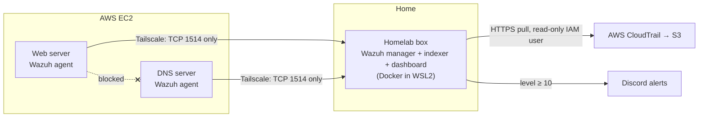

# Wazuh Home SOC

[](https://github.com/pokharelsandeep333-commits/wazuh-home-soc/actions/workflows/rules.yml)

**Sandeep Pokharel · Cyber Operations, Dakota State University · October 2026**

I run two public servers on AWS. One hosts my websites, Nextcloud and a CI/CD project, and the other is a DNS-over-HTTPS ad-blocking resolver. Bots scan them every day, and until this month I had no idea what was hitting them.

So I built a small Security Operations Center (SOC) for them, a setup that collects their security logs and alerts me when something looks wrong. It runs on Wazuh, an open-source SIEM, connected to the servers over Tailscale, a private network built on WireGuard. I tested it by attacking my own servers, and fixing what broke took up most of the week.

This repo has everything needed to rebuild it: the Tailscale policy, the Wazuh config changes, 32 custom rules with a test suite that runs in CI, the setup and hardening scripts, and step-by-step docs including every problem I hit.

Built October 7-14, 2026 · $0 extra cost · Monitors 2 Ubuntu servers on AWS, 1 Windows machine and the AWS account itself

## Why I needed Tailscale

Wazuh needs about 8 GB of RAM. Running it on AWS would have cost $30-70 a month, which my student credits couldn't cover, so the Wazuh server runs at home.

That created a networking problem. Wazuh agents *push* their logs to the server, so my AWS servers have to open a connection into my home network, and home routers drop every connection that starts from the internet.

| Option | Verdict |
|---|---|
| Port forwarding on the home router | Rejected. It exposes a home machine to the whole internet, on a router I don't control |
| Run Wazuh on AWS | Rejected. $30-70/month, and my account couldn't launch the instance sizes needed |
| Plain WireGuard | Rejected. One side still needs an open UDP port, so the NAT problem comes back |
| Reverse SSH tunnels | Rejected. Fragile, one per server, no access control |
| Tailscale (free plan) | Chosen. Every device connects *outward*, so no ports are opened. Policy controls who can reach which port, and it can be tested |

## The network design



I wrote the [Tailscale policy](tailscale/policy.hujson) so that a hacked server can't reach anything else:

- Servers can reach the Wazuh box on TCP 1514 only (the agent port). SSH, SMB, RDP and the dashboard are all refused.
- Servers can't reach each other, which blocks lateral movement. Neither server can even see the other one on the network.
- The policy has built-in tests. Tailscale refuses to save the policy if a test fails, so a bad edit can't silently open a path.
- The Wazuh dashboard, API and database listen on `127.0.0.1` only. I reach the dashboard through an SSH tunnel.
- Once SSH over Tailscale worked, I removed public port 22 from both AWS security groups. Admin access now goes through Tailscale SSH, which ties each login to my Tailscale identity instead of a key file sitting on disk.

<!-- SCREENSHOT: Tailscale policy editor showing the tests block (blur IPs and email) -->
<!-- SCREENSHOT: nmap -Pn -p 22 against both servers' public IPs from outside, showing filtered (blur the IPs) -->

## What it detects

Out of the box, Wazuh gives you login monitoring, rootkit checks and CIS benchmark scoring. On top of that I added:

| Area | What I set up |
|---|---|
| File integrity | Real-time monitoring of SSH config, nginx config and app folders. Alerts arrive within about 1 second and show which user made the change |
| Web attacks | nginx logs from both servers, including a log file I added for the Dockerized nginx, which had only logged to stdout |
| Secrets-file probes | Custom rules 100210-100212 for requests to `/.env`, `/.git/` and `/.aws/`. They escalate if the probe got a 200 (the file may really have leaked) or if one IP keeps trying |
| AWS account | CloudTrail pulled from S3 by a read-only IAM user (CloudFormation). Custom rules for root logins, new IAM users and keys, AdministratorAccess grants, MFA removal and CloudTrail tampering |
| Linux audit | 53 CIS audit rules on the web server, plus custom rules for sudoers changes, kernel modules and sudo-log tampering |
| Containers | Docker events on both servers: `docker exec`, shells inside containers, containers destroyed |
| Vulnerabilities | Host package CVE scanning, tuned so kernel CVEs without an Ubuntu fix don't flood my phone |
| Notifications | Discord message for every alert at level 10 or above, each pointing to my triage playbook |
| Who watches the watcher | A health check every 5 minutes that alerts if Wazuh itself goes down, and an Uptime Kuma "dead-man's switch" on the other machine that alerts if the whole homelab box goes offline |

The rules are in [wazuh/rules/](wazuh/rules/), and [wazuh/tests/](wazuh/tests/) replays 36 sample events through `wazuh-logtest`, most of them in pairs: the event a rule should catch or silence, and a similar one that must still alert. [CI](.github/workflows/rules.yml) runs that suite against a clean Wazuh 4.14.8 manager on every push.

## Attacking my own servers

I didn't want to trust a detection I hadn't seen fire, so I ran a simple attack chain against my own DNS server over Tailscale: 10 failed SSH logins as a fake user, then a real login, then creating and deleting a user. Wazuh linked the events together on its own:

| Time (UTC) | Rule | Level | What Wazuh concluded |
|---|---|---|---|
| 14:19:09 | 5710 ×19 | 5 | Login attempts with a non-existent user |
| 14:19:11 | 5712 | 10 | SSH brute force |
| 14:19:33 | 40112 | 12 | Failed logins followed by a success from the same IP |
| 14:20:03 | 40501 | 15 | Attack followed by a new user being added |

The same chain fired on the web server.

<!-- SCREENSHOT: Threat Hunting, rule.id:(5712 or 40112 or 40501) on 2026-10-09 -->

I tested the other detections live too:
- I requested `/.env` and `/.git/config` on all five of my hostnames, and no site served either file. On the sites behind Cloudflare, Cloudflare's edge blocked `/.env` before it reached the server, so Wazuh only sees the probes that get past Cloudflare.
- A real AWS root console login raised rule 100200 (level 12) about 7 minutes later. CloudTrail delivery plus a 10-minute poll account for the delay.
- Creating, editing and deleting a test file in watched folders on all three machines raised an alert for each step within about 1 second.
- After the move to new hardware (described below), six probe requests produced 100210 five times, then 100212 at level 10. I confirmed the alert in the Discord channel itself, for the reason in problem 5.

<!-- SCREENSHOT: Discord #wazuh-alerts showing a 100212 alert -->
<!-- SCREENSHOT: AWS root login alert 100200 in the dashboard (blur account ID) -->

## Hardening against the CIS Benchmark

Wazuh scores each machine against the CIS Benchmark, a public checklist of secure settings.

| Machine | Before | After | How |
|---|---|---|---|
| Ubuntu 24.04 web server | 53% | 65% | Two scripted batches, each with backups and safety checks (`visudo -c`, `sshd -t`) before applying |
| Windows 11 homelab box | 25% | 45% | Audit policy, account lockout, NTLMv2 only, SMB signing, unused services off |

I didn't aim for 100%, because some checks would break the server. Docker needs IP forwarding, and the separate-partition checks would mean rebuilding the disk. For each check I skipped, I wrote down why and what covers the risk instead (for example: "no host firewall because Docker manages iptables; AWS security group + Cloudflare instead"). That list is called an exception register, and auditors look for one. Mine is in [docs/04-detections.md](docs/04-detections.md#cis-hardening).

<!-- SCREENSHOT: Configuration Assessment showing 65% -->

Along the way I found a bug in Wazuh's own CIS policy. One check (sudo log file) can never pass on any system, because its file pattern is missing an `r:` prefix and gets read as a literal filename. I confirmed it by reading the policy, testing the regex with Wazuh's own tool, and checking that the same line exists upstream, then reported it as [wazuh/wazuh#40275](https://github.com/wazuh/wazuh/issues/40275). A second check had inverted logic, but someone had already reported it in [wazuh/wazuh#31786](https://github.com/wazuh/wazuh/issues/31786).

## What broke, and how I fixed it

These are the eight that taught me the most. All 23 are in [docs/08-troubleshooting.md](docs/08-troubleshooting.md).

**1. The SIEM filled the disk and crashed itself.** On the first start, Docker's Linux VM had no memory cap. It took 13 GB of RAM, Windows grew the pagefile by 7 GB to back it, and the disk hit 0 bytes. The crash cut a database keystore file off mid-write, which left the indexer stuck in a restart loop. I capped WSL memory at 8 GB and recreated the container.

**2. Vulnerability scanning ate 4.4 GB a minute.** I measured it with a baseline, a reading every minute and a stop condition: it used 19 GB in 5 minutes and was only a third done. I turned it off until the move to the homelab box (164 GB free), where the feed loaded in 14 minutes.

**3. Docker's firewall rule overrode mine.** My Windows Firewall rule blocked the agent ports from private LAN ranges, but Docker Desktop had installed its own rule allowing any port from any address on public networks. On campus Wi-Fi, where peers may have non-private addresses, a stranger could have registered a fake agent. I replaced my rule with a block for every address except Tailscale's ranges (block rules beat allow rules) and closed the enrollment port for good. Since then I check what other software already allows before I trust my own rule.

**4. Windows reserved my port, and Docker took every other port down with it.** After a restart, Windows reserved TCP 54965-55064 for itself, and my Wazuh API port (55000) fell inside that range. When one host port fails to bind, Docker publishes none of the container's ports, so the agent port disappeared too and both servers went dark. My health check caught it. I moved the API to a port below Windows' dynamic range.

**5. Wazuh said "sent", but Discord never got the message.** Wazuh has no Discord integration, but Discord accepts Slack-format webhooks, so I used Wazuh's Slack integration. Wazuh logged success while Discord rejected every message with HTTP 400. I tested one field at a time and found the cause: Wazuh sends a timestamp as a decimal string, which Slack accepts and Discord doesn't. One config option overrides that field, so no Wazuh code changed and the fix survives upgrades. Now I check delivery in Discord, where the message is supposed to land.

**6. A "trojaned binary" alert, 58 times.** Wazuh flagged `ls`, `cat`, `chmod` and others on my Ubuntu 26.04 server as trojaned. Before silencing it, I proved it wrong. Ubuntu 26.04 replaced the classic tools with a single Rust binary, and the file was byte-for-byte identical to a fresh copy from Ubuntu's archive. Wazuh's old string signatures were matching normal text inside it. I wrote a narrow rule for exactly those 10 paths and added real-time file monitoring on the real binaries, so tuning out the alert didn't leave a blind spot.

**7. Alert fatigue: 14,000 alerts a day from health checks.** Docker runs every container health check as a `docker exec`, which Wazuh reports. I wrote six tuning rules, each matching one exact command in one exact container. A shell or an extra command in the same container still alerts, and I tested that. My phone now gets about 0-2 alerts a day, and they're real.

**8. The SIEM died and nothing told me.** Twice, the Wazuh manager container showed "Up" while every process inside it was dead. Every alert comes from Wazuh, so nothing alerted. I built a separate health check that tests the actual processes, agents and event flow, and posts DOWN and RECOVERED messages to Discord. When the "container up, zero processes" failure came back after a reboot, I added a one-time automatic restart.

## Moving it to dedicated hardware

The SIEM started on my daily laptop, which sleeps, reboots for updates and was nearly out of disk. On October 14 I moved everything to an old laptop that runs 24/7 (a retired university machine that was released to me):

- I moved all 14 Docker volumes (alert history, agent keys, CloudTrail progress). The agents only needed a new address, with no re-enrollment.
- Downtime was about 12 minutes. The agents buffered their events in the meantime, so nothing was lost.
- I updated the Tailscale policy, verified that the servers can no longer reach the old machine, then wiped the old copy.
- I added a Wazuh agent to the homelab box itself, so the SIEM host is monitored too.

## Rebuild it yourself

Follow the docs in order. Every value in angle brackets (`<WAZUH_MANAGER_IP>`, `<CLOUDTRAIL_BUCKET>` and so on) is a placeholder for your own.

1. [Tailscale: the private network](docs/01-tailscale.md), before anything else
2. [Deploy Wazuh](docs/02-wazuh-deploy.md): host prep, port lock-down, firewall, passwords
3. [Agents](docs/03-agents.md)
4. [Detections, tuning and CIS hardening](docs/04-detections.md)
5. [AWS CloudTrail](docs/05-cloudtrail.md) (optional)
6. [Discord alerts](docs/06-discord-alerts.md)
7. [The watcher, dead-man's switch and moving the SIEM](docs/07-watcher-and-migration.md)
8. [Troubleshooting](docs/08-troubleshooting.md)

Some parts are specific to my machines, and the docs say so where it matters: the Wazuh host is Windows with WSL2 (first Docker Desktop, later Docker Engine inside Ubuntu), one server runs Ubuntu 26.04, and the container names in the tuning rules are examples you must replace with your own.

```
├── tailscale/policy.hujson          access policy with built-in tests
├── wazuh/
│   ├── manager/                     compose changes + manager config snippets (aws-s3, Discord, vulnerability detection)
│   ├── agent/                       agent config snippets (FIM, nginx logs, Docker listener, audit log)
│   ├── rules/                       home_soc_detections.xml, home_soc_tuning.xml
│   └── tests/                       36 logtest cases + runner
├── scripts/
│   ├── server/                      agent install, web logs, Docker listener, CIS batches, sudo.log rotation
│   ├── manager/                     rule deploy, watcher + systemd units, Discord and AWS secret helpers
│   └── windows/                     CIS Windows 11 hardening
├── aws/wazuh-cloudtrail-reader.yaml read-only IAM user (CloudFormation)
└── docs/                            the eight guides above
```

## Limits

- This is a home lab watching three machines, and I'm the only one on call.
- Vulnerability scanning covers host packages, not software inside Docker images. Container image scanning is the next step.
- Wazuh has no CIS policy yet for Ubuntu 26.04, so my DNS server has no hardening score.

## How I built it

I designed it, made the security decisions, ran the attack tests, and ran everything that needed admin rights or a secret myself. I used Claude Code as an assistant for research, scripting and troubleshooting, and kept a dated build log of every step, including what failed. Every result here comes from that log.

## Evidence

- Bug report to Wazuh: [wazuh/wazuh#40275](https://github.com/wazuh/wazuh/issues/40275)
- Rule tests: the [CI runs](https://github.com/pokharelsandeep333-commits/wazuh-home-soc/actions/workflows/rules.yml) on this repo
- Screenshots and a walkthrough video: coming soon in [docs/evidence/](docs/evidence/)
- I'm happy to demo it live.

Tools: Wazuh 4.14.8 · Tailscale · Docker · WSL2 · AWS EC2, CloudTrail, IAM, CloudFormation · Ubuntu 24.04 / 26.04 · Windows 11 · nginx · Cloudflare · Discord · Uptime Kuma

License: [MIT](LICENSE) · Security notes: [SECURITY.md](SECURITY.md)
