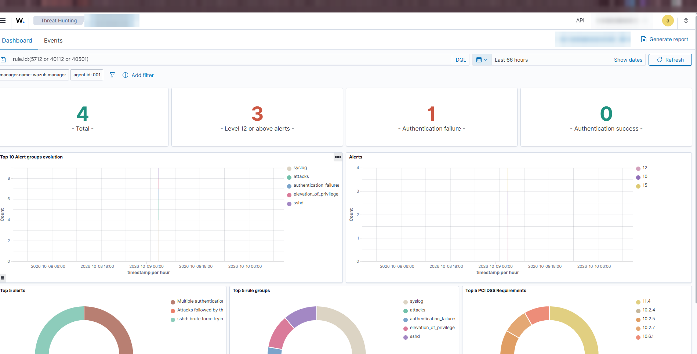
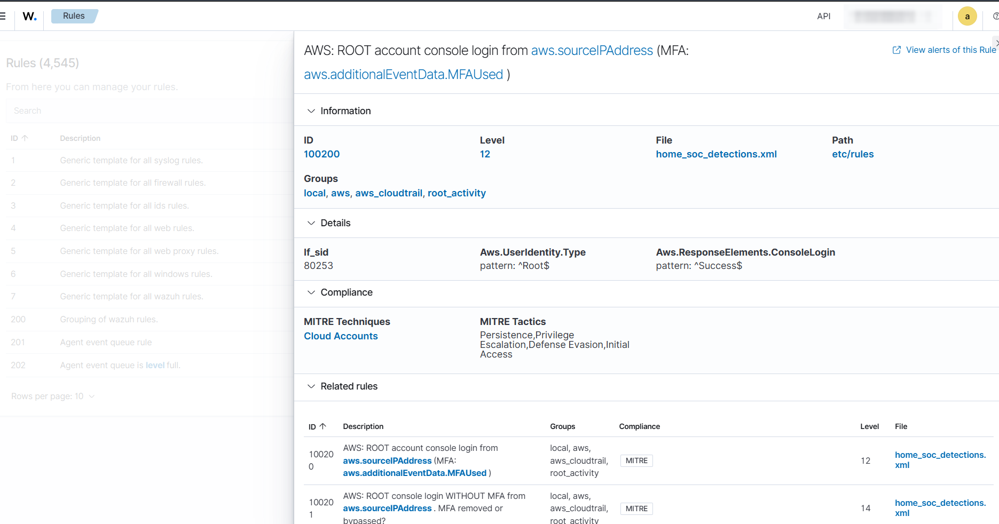

# Evidence

Screenshots from my live Wazuh dashboard. Server names, the browser address bar and the Wazuh API ID are blurred.

## CIS hardening on the web server (Oct 9 2026)

Before: **53%** (127 passed, 110 failed, 42 not applicable), scan finished 13:03.

After two hardening batches: **65%** (172 passed, 90 failed, 17 not applicable), scan finished 13:37. "Not applicable" dropped from 42 to 17 mostly because installing auditd made the audit checks applicable.

## Brute-force attack chain (Oct 9 2026)

Threat Hunting filtered on `rule.id:(5712 or 40112 or 40501)` for the web server: 4 alerts, 3 of them at level 12 or above.

## Discord alert (Oct 14 2026)

The end-to-end test after moving the SIEM to new hardware: six requests for `/.env` from one IP made rule 100212 (level 10) fire on the DNS server, and Wazuh posted it to the private `#wazuh-alerts` channel. The source IP and agent name are blurred.

## Tailscale policy tests

The `tests` block of the live Tailscale policy. Tagged servers must reach the Wazuh host on TCP 1514, and every other listed path (enrollment port 1515, SSH, the dashboard, the indexer, SMB, RDP, the old Wazuh host and server-to-server SSH) must be denied. Tailscale refuses to save the policy if any of these fails. The old host's Tailscale IP is blurred.

## Custom rule loaded in the live manager

Rule 100200 (AWS root console login, level 12) as Wazuh lists it: loaded from `home_soc_detections.xml`, a child of 80253, MITRE T1078.004. This shows the rule definition, not an alert; the live test result (a root login caught about 7 minutes later) is in [docs/05-cloudtrail.md](../05-cloudtrail.md).

## Still to add

- [ ] An AWS root-login alert (100200) firing, from Threat Hunting → Events
- [ ] The brute-force chain in the Events tab (one row per rule, with times)
- [ ] `nmap -Pn -p 22` against both servers from outside the tailnet
- [ ] Walkthrough video (2-3 min): live brute-force test → dashboard → Discord
